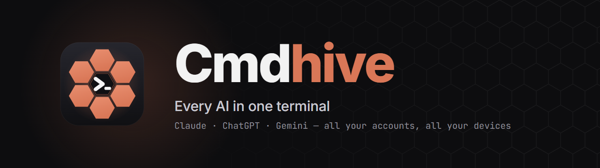
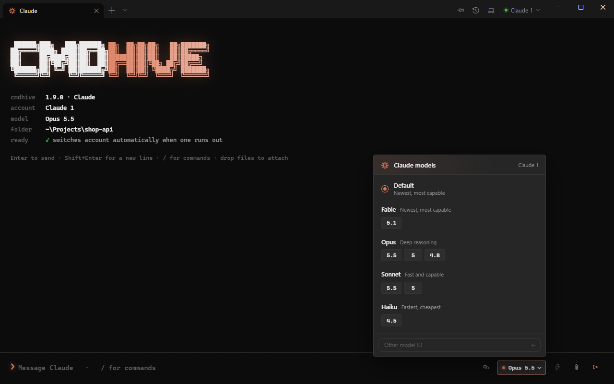
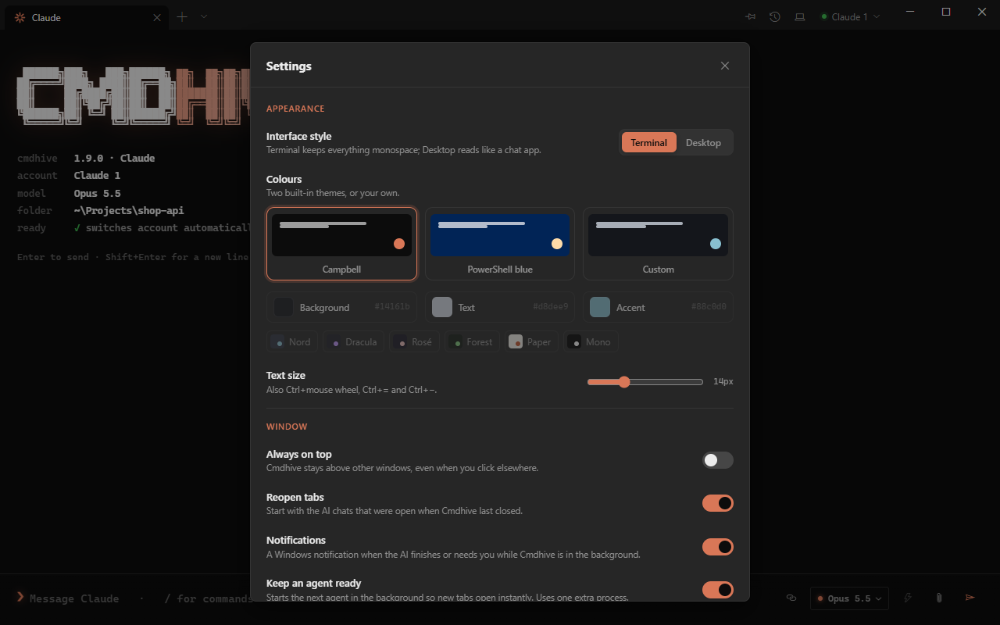

<p align="center"></p>

<p align="center">
  <a href="https://github.com/cmdhive/cmdhive/releases/latest"></a>
  <a href="https://github.com/cmdhive/cmdhive/releases"></a>
  
  
  
</p>

**[cmdhive.org](https://cmdhive.org)** · Cmdhive was called AIT until version 1.8.0; nothing changes for you.

Cmdhive is a terminal app for Windows and Mac built around AI coding agents. It runs Claude Code,
Codex (ChatGPT) and Gemini CLI in a clean, fast chat view instead of a raw console,
and keeps a conversation going across several of your accounts: when one account
reaches its usage limit, Cmdhive moves the same conversation to the next one and carries on.

<p align="center"></p>

## Download

**[Download Cmdhive for Windows](https://github.com/cmdhive/cmdhive/releases/latest/download/Cmdhive-setup.exe)**,
then run the installer. It installs for your user only, so it doesn't need administrator rights.

Cmdhive updates itself: when a new version is out, an **Update** button appears in the title bar.

> Cmdhive isn't code-signed yet, so Windows SmartScreen may say it doesn't recognise the app the
> first time. Choose **More info → Run anyway**. Every release lists its SHA-256 checksum.

### On a Mac

**[Download Cmdhive for Mac](https://github.com/cmdhive/cmdhive/releases/latest/download/Cmdhive-mac.zip)**
(Apple silicon and Intel, macOS 12 or newer). Unzip it and drag **Cmdhive** to Applications.

Cmdhive isn't signed with an Apple developer certificate, so the first time: right-click Cmdhive →
**Open** → **Open**. (On macOS 15, if that is not offered, open **System Settings → Privacy &
Security** and choose **Open Anyway**.) After that it starts normally and updates itself.

What differs from Windows: the AIs' browser opens in your own Google Chrome (or Edge, Brave,
Chromium) instead of Cmdhive's live window with the steps column; the steps and any question for
you appear in the chat. There is no tray icon or tray panel; the Dock icon bounces and a
notification appears instead. ⌘ takes the place of Ctrl in Cmdhive's shortcuts.

### The AI tools

Cmdhive runs each AI's own command-line tool. On first start, the setup wizard installs the ones
you don't have yet (Claude Code, Codex for ChatGPT, Gemini CLI), and you can switch off any you
don't want. Codex and Gemini need Node.js; if it's missing, Cmdhive installs it from nodejs.org
and Windows asks for permission. To install a tool yourself instead:

| AI | Install |
|---|---|
| Claude | `npm install -g @anthropic-ai/claude-code` |
| ChatGPT | `npm install -g @openai/codex` |
| Gemini | `npm install -g @google/gemini-cli` |

Cmdhive finds them by itself and uses the accounts you are already signed in with.

**AI rules.** The rules every AI follows first are edited in the app (menu → AI rules), with ten
presets to start from.

## Features

- **Native chat** for Claude and ChatGPT. Streaming replies, rendered markdown,
  syntax-highlighted code with copy buttons, and tool calls you can expand to see the diff
  or the output.
- **Approval cards.** When the AI wants to edit a file or run a command, you allow it once,
  always, or deny it. Or switch approvals off in Settings.
- **Several accounts, one conversation.** Add Claude, ChatGPT and Gemini accounts from one
  account menu; each signs in through your browser. When one runs out, the conversation
  continues on the next, with its full history.
- **Model and effort picker.** Every version your AI offers (Opus 5.5, 5, 4.8 …, GPT-5.6 Sol,
  Luna …), read from the installed tools, chosen per chat, with the thinking effort each
  model supports. Claude models can use a 1M-token context.
- **Usage at a glance.** Under the prompt: how much of the 5-hour and weekly limits the
  account has used and when it resets, how full the context is, and how long the last reply took.
- **One conversation across AIs.** When every account of one AI runs out, the conversation
  continues on the next AI (Claude → ChatGPT → Gemini), which is handed the history so far.
  Or have Cmdhive ask first, or wait for the reset.
- **Shared memory.** One memory folder every AI reads and adds to, so what one learns the
  others know.
- **Device connector.** Share that memory between your own computers, so the AI on your
  laptop knows what it worked out on your desktop. The button at the top right connects a
  PC or Mac through a folder they both already reach — iCloud Drive, OneDrive, Dropbox,
  Syncthing, a network share, even a USB stick. Each device keeps its memories in its own
  place inside it, so nothing is ever overwritten and the AIs always know which device a
  memory came from. No account, no server, nothing to pay for. See
  [Connecting your devices](#connecting-your-devices).
- **Tray.** Cmdhive lives in the tray too: click the icon for a small panel with what the AI is doing,
  its latest reply, usage, and a box to type to it. Hide Cmdhive to the tray and the AI keeps working;
  a Windows notification tells you when it finishes or needs you.
- **Tabs come back.** The AI chats open when Cmdhive closed reopen at the next start (Settings to switch off).
- **History.** Search and reopen any past conversation (Ctrl+Shift+H); find text inside a chat with Ctrl+F, or save one as Markdown with `/export`.
- **MCP servers.** The plug button next to the model shows the AI's own MCP servers and their
  status, with a switch for each; what you switch off stays off in every chat of that AI.
- **Two looks.** A terminal style and a desktop chat style, Campbell and PowerShell-blue
  themes, or your own colours.
- **Also a terminal.** PowerShell and Command Prompt tabs, Windows Terminal-style. Ctrl+1–8 jump
  to a tab, Ctrl+9 to the last.
- Attach files by pasting, dragging them in, or with the paperclip. Zoom with Ctrl+mouse wheel.

## Connecting your devices

Every computer running Cmdhive can share one memory. There is no server and no sign-up: the
devices talk through a folder you already sync between them.

1. On the first computer: **Device connector** (top right) → **Connect a device**. Pick one of
   the synced drives Cmdhive found, or choose any folder.
2. On the second: the same, and pick **the same folder**. Cmdhive creates a `Cmdhive Memory` folder
   inside it.

Within half a minute each device shows up in the other's dropdown, with what it is called,
when it was last used and how many memories it shares.

Your own memories stay where they are, at the top level of your memory folder. What the other
devices remember is mirrored in beside them, one folder per device:

```
memory/
  MEMORY.md             this device's memories, exactly as before
  stud-building.md
  from-macbook/         the MacBook's, read-only (Cmdhive keeps it in step)
    MEMORY.md
    vacation-notes.md
  DEVICES.md            which device is which (Cmdhive writes this)
```

The AIs are told about this, so they read every device's memories but only ever write their
own, and they can say which device something was learned on — which matters when paths,
installed tools or hardware differ.

- A device only ever writes its own folder in the shared area, so two computers can never
  edit the same file and your drive can't leave conflict copies behind.
- Offline is fine. On a plane, or with the drive unmounted, every memory is still there and
  the AIs keep using it; changes go out when you are back.
- **Disconnect this device** stops sharing and removes the other devices' memories from it.
  Its own are untouched. **Forget** does that for one device only.
- With one device connected, nothing changes at all: the memory folder stays exactly as it is.

## Screenshots

| | |
|---|---|
|  |  |
| Desktop style | Approving a command |
|  |  |
| Model switcher | Settings |
|  |  |
| First-run setup | PowerShell blue |

## Privacy and safety

- Cmdhive has no account, server or telemetry. Your chats stay where the AI tools already keep them.
- Connected devices share memory through a folder of your own. Nothing passes through
  anything the author runs, and Cmdhive itself uploads nothing.
- It never opens login or token files. It only checks whether they exist, to tell whether
  you're signed in.
- Its only network access of its own is checking this repository for updates. You can turn
  that off in Settings.
- Updates are downloaded only from this repository's releases, over HTTPS, and are installed
  only if they match the release's published SHA-256 checksum.
- The AI gets the folder access you choose in Settings, and approval cards still apply.

Each AI provider has its own terms of service. Make sure your use, including use of more
than one account, follows them. Cmdhive isn't affiliated with Anthropic, OpenAI or Google.

## How account switching works

Each AI tool keeps a log of every conversation on disk. Cmdhive watches that log; when the tool
records a usage-limit or signed-out error, Cmdhive copies the conversation into the next
account's folder and resumes it there with "continue". Each account keeps its own folder,
so nothing about a login is shared or moved.

## Building from source

Needs Go 1.27+, [Wails v2](https://wails.io) and, for the installer, [NSIS](https://nsis.sourceforge.io).

```sh
go test ./...                    # unit tests, including a fake-CLI account switch
wails build -s -trimpath         # build/bin/Cmdhive.exe
wails build -s -trimpath -nsis   # also build/bin/Cmdhive-amd64-installer.exe
wails build -s -trimpath -platform darwin/universal   # on a Mac: build/bin/Cmdhive.app
```

The Mac app is built by GitHub Actions ([`mac.yml`](.github/workflows/mac.yml)) whenever a release
is published, and attached to it as `Cmdhive-mac.zip`.

Releases are published with `scripts/release.sh <version> "<notes>"`.

### Adding another AI

Every AI goes through one interface, `Provider` in [`provider.go`](provider.go). A new AI is
one file that implements it, plus one line in `providers()`. To get the native chat view,
it also implements `ChatProvider` in [`chat.go`](chat.go). See
[`provider_claude.go`](provider_claude.go) and [`provider_codex.go`](provider_codex.go).

Gemini support is basic for now: tabs and model choice work, but automatic account
switching and history need its log format to be added.
